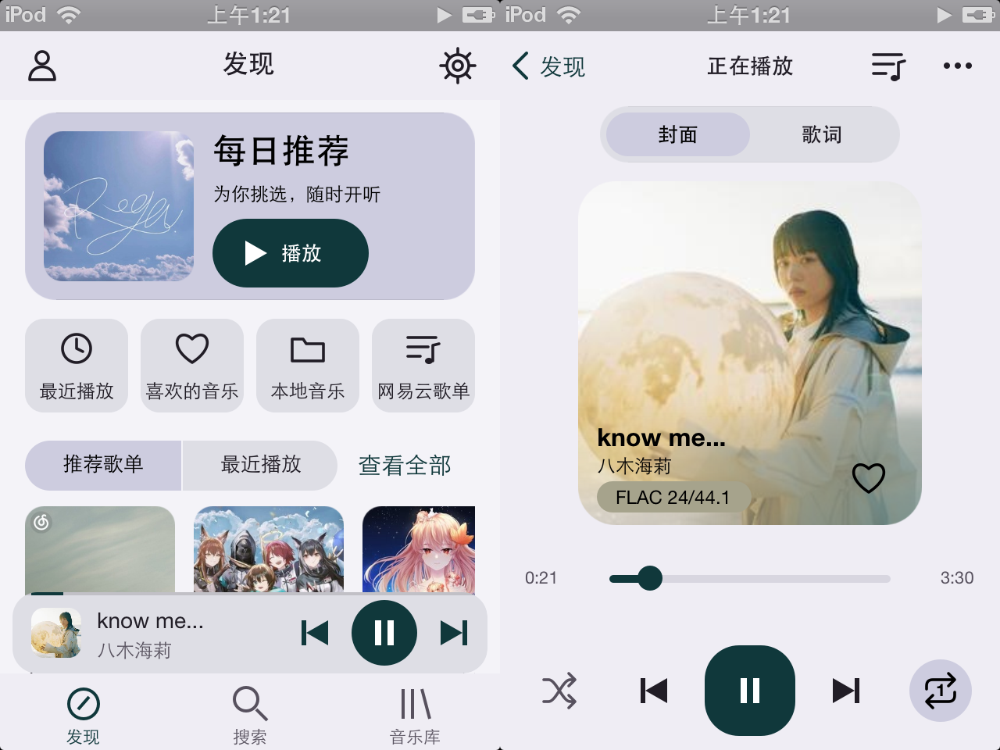

# 暮雨音乐 · Muyu Music

为 **iOS 6.0+／ARMv7 越狱设备**打造的原生音乐播放器，将网易云音乐、本地曲库、同步歌词和 Material You 风格界面放在一起。

## 功能介绍

### 网易云音乐

- 扫码登录网易云账号，搜索歌曲、歌手、专辑和歌单。
- 浏览每日推荐、推荐歌单和“根据你喜欢的歌曲推荐”。
- 查看网易云喜欢的音乐，按添加时间从新到旧排列，并支持搜索歌名、歌手和专辑。
- 浏览账号歌单，将歌曲加入自己的网易云歌单，收藏推荐歌单。

### 本地音乐与曲库

- 通过 iTunes 文件共享导入 MP3、AAC/M4A、ALAC、FLAC、WAV、AIFF 等音频。
- 支持子目录扫描、歌曲搜索、本地收藏、本地歌单和最近播放。
- 识别封面与音频信息，加载与歌曲同名的本地 `.lrc` 歌词。

### 播放体验

- 沉浸式专辑封面，歌名、歌手、音质和收藏按钮直接显示在封面内。
- 自适应多色渐变与深浅文字，让歌曲信息融入封面；点按封面可淡入、淡出歌曲信息。
- 支持封面／歌词切换、点击歌词定位、播放队列、进度拖动、随机播放与循环播放。
- 底部迷你播放器支持上一首／下一首、滑动切歌和相邻歌曲预览。
- 显示实际音频格式、位深、采样率等音质信息，点按可查看完整参数。

### 同步歌词

- 支持原文、同步译文与日语罗马音，提供独立显示开关。
- 罗马音可替换原文，缺少对应内容时保留原文。
- 长歌词和双语歌词自动调整行高，当前歌词高亮并居中跟随。

### 主题与界面

- Material You 风格的卡片、按钮、分段控件与圆角播放器。
- 支持深色模式、跟随封面配色、自定义主题色与 HEX 颜色。
- 动画效果可随时开关，并记住选择；适配小屏 iPhone／iPod touch 与 iPad。

### 音源与缓存

- 支持网易云直连、自定义 API 和兼容网易云 `wy` 的洛雪音源脚本。
- 支持音源仓库订阅、手动同步、自动检查更新和下载加速选择。
- 提供 HTTPS 开关、错误详情、歌曲缓存上限和缓存清理。
- FLAC 支持增量解码与预缓存，本地曲库和主题可离线使用。

## 界面预览



## 下载

当前版本：**1.3.13／构建 32**。

- [下载安装包（iOS 6／ARMv7）](https://github.com/muyuawa/MuyuMusic/releases/download/v1.3.13-ios6-build32/MuyuMusic-1.3.13-ios6-armv7.ipa)
- [下载对应源码](https://github.com/muyuawa/MuyuMusic/releases/download/v1.3.13-ios6-build32/MuyuMusic-source-1.3.13-ios6.zip)
- [SHA-256 校验文件](https://github.com/muyuawa/MuyuMusic/releases/download/v1.3.13-ios6-build32/SHA256SUMS-1.3.13-ios6.txt)
- [查看更新日志](https://github.com/muyuawa/MuyuMusic/releases/tag/v1.3.13-ios6-build32)

## 使用

1. 从 [GitHub Release](https://github.com/muyuawa/MuyuMusic/releases/tag/v1.3.13-ios6-build32) 下载 `MuyuMusic-1.3.13-ios6-armv7.ipa`，或使用本地构建的 `dist/MuyuMusic-1.3.13-ios6-armv7.ipa`，按 [安装说明](docs/INSTALL.md) 安装。
2. 在音乐库 → 账号与扫码登录，使用另一部手机的网易云音乐扫码并确认。登录前也可搜索和浏览公共内容；实际播放由平台权限决定。
3. 发现页浏览推荐歌单或登录后查看每日推荐；搜索支持歌曲、歌手、专辑与歌单。歌曲右侧按钮可加入队列、收藏、添加本地歌单、修改网易云喜欢状态或浏览歌手/专辑。
4. 用 iTunes 文件共享向“暮雨音乐”添加 MP3、AAC/M4A、ALAC、FLAC、WAV、AIFF。可以添加子目录；同名 `.lrc` 与音乐放在一起。回到应用自动扫描，也可手动扫描。
5. 底部播放器进入正在播放，切换封面/歌词、点击歌词定位、调整进度、循环、随机和编辑队列。设置可切换深浅模式、开启跟随封面配色、自定义 HEX 主色和在线音质。
6. 歌单中个别歌曲暂无详情时，显示已返回的真实歌曲与缺失数量，可重试；不会使整张歌单无法打开。
7. FLAC 输出采用有上限的 PCM 缓冲（44.1 kHz 双声道约 1.5 秒），合并短音频帧并在耗尽后补足再恢复。
8. 在线 FLAC 预缓存约 5 秒音频后起播。设置可选择歌曲缓存上限（默认 256 MB，可关闭或选择 64 MB～1 GB）、查看占用并清理；清理保护当前播放文件。缓存重播仍需联网确认账号权限。

设置 → 音源，可保留网易云直连，或导入支持网易云 `wy` 的洛雪 `.js`、添加自定义 API。默认开启“仅允许 HTTPS”；长青等返回 HTTP 地址的音源需关闭此选项后重试。首次导入不会自动启用，脚本和 API 不获得网易云登录凭据。详见 [音源说明](docs/CUSTOM-SOURCES.md)。

“仓库音源”动态显示 [pdone/lx-music-source](https://github.com/pdone/lx-music-source) 的 `latest.js`。导入后可手动同步，也可在回到前台时每天自动检查。下载方式可选择 GitHub 官方接口、`ghproxy.net` 及仓库列出的备用加速站点；更新先校验，失败保留旧版。同步不自动导入其他源或切换当前来源。

“无损优先”是请求偏好；音质标识来自实际音源/解码信息。网易云直连中没有完整播放权限的试听链接会被拒绝。自定义源由用户配置，其代码许可、服务权限和音乐内容授权需分别确认。

## 构建

实测环境：Intel macOS、Apple clang 21.0.0、ld-classic、iOS 7.1 SDK、CMake 3.31.12、Python 3。无需完整 Xcode；需要可生成 ARMv7 的 clang/ld-classic 和 CMake。Apple Silicon 可运行对应 Intel 工具时再尝试，尚未验证。

```sh
python3 scripts/bootstrap.py
python3 scripts/draw-assets.py
bash scripts/build-deps.sh
bash scripts/build.sh
```

已有合法 SDK 可设置 `IOS_SDK=/absolute/path/iPhoneOS7.1.sdk`。`bootstrap.py --no-sdk` 只准备开源依赖与构建工具。构建输入均校验 SHA-256，依赖发行归档下载到被忽略的 `vendor/archives/`；SDK 不随源码再分发。CMake 可通过环境变量 `CMAKE` 指定路径。

仓库及源码包保留程序、应用资源、原始图标素材、构建脚本、测试、许可证与必要文档。SDK、依赖缓存、构建产物、设备日志、截图和设计草稿由 `.gitignore` 排除。IPA 与校验文件通过 Releases 提供。

提供 Theos `Makefile`，架构 `armv7`、SDK 7.1、最低系统 6.0。准备 `.build/deps` 后可在已配置的 Theos 环境尝试 `make package`；**本次实际执行并验证的是 `scripts/build.sh`，Theos 分支未实测**。最低系统版本为 iOS 6.0。

构建脚本逐个编译全部源文件，静态链接 libFLAC/libcurl/Mbed TLS，使用 SHA-1 ad-hoc 签名，再检查 Mach-O、系统依赖、entitlements、CA、许可证、文件共享与后台音频配置。生成文件位于 `dist/`，文件名包含 `ios6`，不会覆盖原版 IPA。依赖首次切换分支时会按目标重新构建；包检查会逐个检查静态库成员的系统版本。

## 必要测试

```sh
python3 scripts/bootstrap.py --no-sdk # 新克隆先准备已锁定的测试依赖
bash scripts/test.sh          # 本机确定性测试：协议/曲库/播放数据通路/主题
bash scripts/test.sh --tls    # 另测实际捆绑 TLS 后端和一次真实搜索；首次会编译主机依赖
bash tests/source_repository_live.sh ghproxy.net # 可选：真实仓库目录/加速下载/初始化，不测试音乐播放
```

完整公共接口探测保留为可选的 `tests/network_live.sh`，默认不重复执行。测试覆盖编码、二维码解码回读、音频起播时机、歌词、主题与页面布局；`bash tests/ios6_compile.sh` 检查全部源文件的 iOS 6 API 可用性。

## 代码导航

- `Sources/Network`：HTTPS、加密接口、Keychain 会话、登录和权限处理。
- `Sources/Library`：串行 SQLite、文件扫描、受限元数据/封面提取、LRC。
- `Sources/Playback`：统一队列、AVPlayer、渐进式资源加载、libFLAC/AudioQueue。
- `Sources/UI`：原生发现/搜索/音乐库/详情/播放/账号/设置、主题、封面缓存。
- `scripts`：可执行构建、校验与必要测试入口。

模块边界见 [接口契约](docs/INTERFACES.md)。具体实现与限制见 [网络](docs/NETWORK.md)、[曲库](docs/LIBRARY.md)、[播放](docs/PLAYBACK.md)。[依赖与许可证](docs/DEPENDENCIES.md) 包含第三方来源；许可证原文同时附在 IPA 内。
